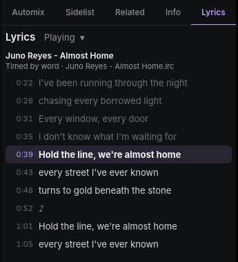
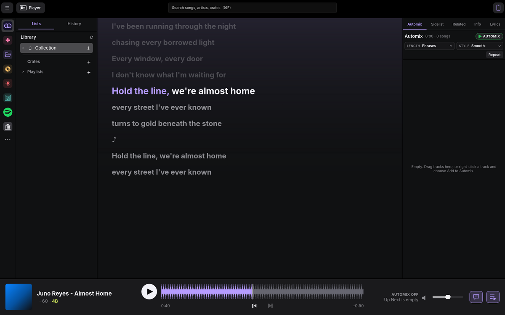
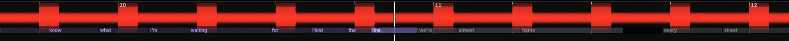
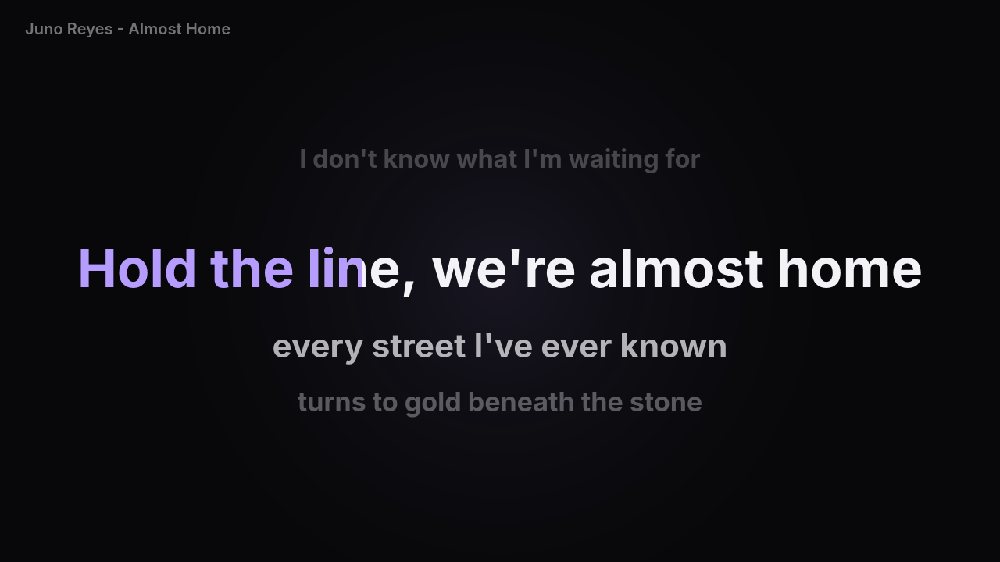
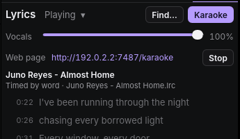
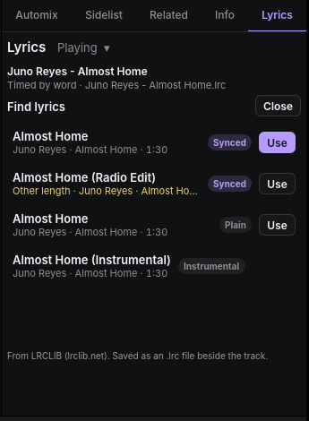

# Lyrics

DJ Sugar shows the lyrics of the track playing in the **Lyrics** tab of the
side panel (next to Info). When the lyrics are timed, the line being sung
is lit and kept in view, and clicking a line plays the deck from there.

## Where lyrics come from

DJ Sugar reads lyrics you already have. It looks for them in this order:

1. **An `.lrc` file beside the track**, with the same name: `Song.lrc` (or
   `Song.mp3.lrc`) next to `Song.mp3`. Tools such as LRCGET write these.
   Plain LRC gives a time for each line; enhanced LRC, with a time before
   each word (`<00:10.40>the`), gives a time for each word.
2. **The track's tags**: timed lyrics in an MP3's `SYLT` frame, and lyrics
   in `USLT` (MP3), `LYRICS` (FLAC and Ogg) and `©lyr` (M4A). Lyrics in
   these that are written as LRC are read as timed.

DJ Sugar never fetches or sends lyrics on its own. To look them up online,
see [Find lyrics online](#find-lyrics-online).

## What the tab follows

The menu beside **Lyrics** picks the track:

- **Playing track** (the default): the deck playing, staying with it while
  it plays. When nothing plays, the deck played last, or the first deck
  with a track.
- **Selected track**: the track selected in the browser. Its line is lit
  when it is also on a deck.
- **Deck A** or **Deck B**.

Under the track's name the tab says how the lyrics are timed (by word, by
line, or not timed) and where they came from.

## In Player mode

The speech bubble button on the Player bar opens **Now Playing** on its
**Lyrics**: the lyrics of the track playing large, beside its album art. The line being sung is big and
white, and when the lyrics are timed by word, the words already sung turn
lilac. Lines gone by fade, and a ♪ marks a break in the singing. Click a
line to play from it. Press the button again, or the ⌄ at the top left, to go back to the list.

## On the waveforms

When a track on a deck has timed lyrics, they run along the bottom of its
big waveform, scrolling with the audio, so you can see where the singing is
and what comes next while you mix. Each word sits at the moment it is sung,
on a faint strip for its line. The word being sung is lit and fills with
cyan, and words already sung stay cyan. Lyrics timed only by line have
their words spread over the line by length; [Time words](#time-words)
places them exactly. They show while **Vocals** is set
to **Lyrics** (the default) in the drop-down on the waveforms button in the
top bar; **Bar** shows a cyan bar where someone sings instead.

## Time words

Lyrics timed only by line (most of what LRCLIB has) light a whole line at
once. **Time Words**, under the track's name in the Lyrics tab, gives each
word its own time, so words fill as they are sung on the karaoke screen,
in Player mode and on the waveforms.

DJ Sugar listens to the track's vocals with Whisper, on your computer:
nothing is sent anywhere. It separates the vocals first if the track has
no stems yet, then lines up the lyrics you have with the words it hears.
Words it can't make out are placed between those it can. The lyrics are
saved as an `.lrc` beside the track, timed by word.

The first time, DJ Sugar downloads the Whisper model (about 550 MB). A track
takes a minute or so on a recent Mac. If Whisper can't make out enough of
the words, say for a track sung in a heavy mix or lyrics for another
version, the lyrics are left as they were and the tab says so.

### Transcribe

A track with no lyrics at all shows **Transcribe** in the Lyrics tab.
DJ Sugar listens the same way and writes down the words it hears, timed by
word and split into lines at the pauses. They are saved as an `.lrc`
beside the track, and the tab says **Transcribed by DJ Sugar**, since words
heard by ear can be wrong. Find or your own `.lrc` can replace them at
any time.

## Karaoke screen

**Karaoke** in the Lyrics tab (or **Karaoke Screen** at the top right of
Player mode's lyrics) opens the lyrics in a window of their own, for a TV,
a projector or a second display. When another display is connected, the
window opens full screen there. Double-click it, or press F, to switch full
screen on or off; Esc leaves full screen. Close it with Karaoke again, or
its window's close button.

The line to sing is big in the middle, with the line before it faded above
and the next two lines below. The word being sung fills with lilac as it is
sung. Lyrics timed only by line have their words spread over the line by
length, so the fill is close but not exact; lyrics timed by word fill word
for word. After a break in the singing, the next line shows early, with
dots above it counting in the last four beats at the deck's tempo.

Like Player mode's lyrics, the screen follows the track playing, so it
moves over with Automix. While it is open, the Lyrics tab follows the
track playing too.

### On a TV or another device

The karaoke screen can also be a web page, for a smart TV's browser, a
tablet, or a laptop plugged into a projector. With the karaoke screen open,
press **Share** beside **Web page** in the Lyrics tab. The tab shows the
page's address, such as `http://192.168.1.20:7487/karaoke`: open it in a
browser on any device on the same network. The page shows the same lines,
word fill and count-in as the window, and keeps time itself between
updates. **Stop** takes it off the network; closing the karaoke screen
stops it too. DJ Sugar remembers whether you shared it.

### Turning the voice down

While the karaoke screen is open, the Lyrics tab has a **Vocals** slider:
the level of the vocal stem on the deck the screen follows, from none on
the left to full on the right. Leave a little in as a guide for singers, or
take it all out. The level you set is kept for the next track the screen
follows, so a whole night can run with the voice down. Stems are separated
when a track loads, and the slider works once they are ready.

## Find lyrics online

DJ Sugar can look a track up on [LRCLIB](https://lrclib.net), a free
community database of synced lyrics. Press **Find…** in the Lyrics tab. DJ Sugar asks LRCLIB for the track by
its artist, title, album and length, and lists what it has, best first:
synced lyrics of the same length at the top. **Other length** marks lyrics
for another version of the track (a radio edit, say), whose timing won't
fit. **Use** saves the lyrics as an `.lrc` file beside the track, where
other apps find them too. If the track's folder can't be written, DJ Sugar
keeps them in its own settings folder instead.

Only the track's names and length are sent to LRCLIB, and only when you
press Find. To stop DJ Sugar asking LRCLIB at all, turn off **Find lyrics
online** in Settings › Collection › Health.
